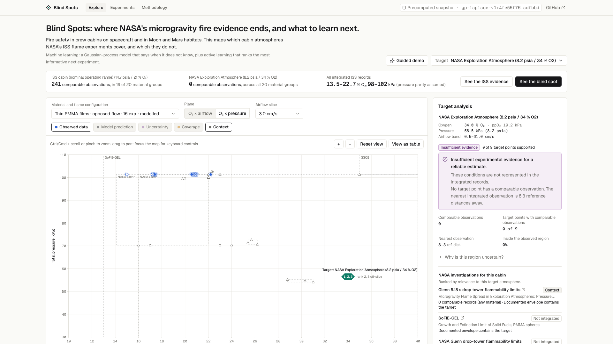

# Blind Spots

**Blind Spots: where NASA's microgravity fire evidence ends, and what to learn next.**

NASA's next crew cabins are planned at 8.2 psia and 34 % O2. All 250 integrated ISS flame tests (BASS, BASS-II)
ran at about 1 atm. Blind Spots measures that gap: 241 comparable observations for the ISS cabin,
0 for the Exploration Atmosphere in every material group. There, a Gaussian-process model answers
"Insufficient experimental evidence for a reliable estimate." and active learning ranks what would teach the most.
Built for NASA Space Apps Challenge 2026, "Flame in Freefall"; not endorsed by NASA.

**Try it:** [live app](https://blind-spots-kappa.vercel.app) (press **Guided demo**) · [30-second video](https://blind-spots-kappa.vercel.app/video/blind-spots-demo-30s.webm) · [source code](https://github.com/Atharv-Sharma06/blind-spots)



## The 60-second pitch

- **The question.** Future exploration cabins are planned at lower pressure and higher oxygen than the ISS (NASA's
  Exploration Atmosphere: 8.2 psia / 34 % O2). NASA's lunar Surface Habitat study states: "SH is assumed to operate at a nominal atmospheric operating pressure of 10.2 psia and 26.5% oxygen concentration and a capability of operating at 8.2 psia and 34% oxygen" (NTRS 20220000245, PDF p. 4). How much of NASA's microgravity flame evidence
  actually covers that air?
- **What we built.** We turned 250 ISS flame tests (BASS and BASS-II, NASA PSI) into 749 flow-step
  observations in which every value links to its NASA source cell. For a chosen cabin atmosphere, Blind Spots shows the
  comparable evidence, what an uncertainty-aware model predicts, where it refuses to guess, and which computation would
  reduce its uncertainty about that atmosphere the most.
- **The finding.** All integrated ISS records lie at 13.5 to 22.7 % O2 and 98.3 to 102.2 kPa. The ISS cabin has
  241 comparable observations, in 19 of the 20 material and flame-configuration groups; the NASA
  Exploration Atmosphere has 0, in every group (nearest 8.1 to 10.3
  reference distances). So the app answers "Insufficient experimental evidence for a reliable estimate." instead of
  printing a probability.
- **What is different.** Most dashboards show what was tested. Blind Spots shows where the integrated evidence stops for the
  air a crew will breathe, keeps "lack of data" apart from "outcome variability", withholds estimates outside its
  evidence, and ranks the next research question by expected information about that target, next to random,
  uncertainty-sampling and nearest-gap baselines.

## Headline finding

Computed by `docs/_gen/build.py` from `POST /api/target/assess` for every analysis group (the same responses the static
snapshot serves), dataset `4fe55f76142a`, model `gp-laplace-v1+4fe55f76.adfbbd`:

| documented atmosphere | O2 % | pressure kPa | comparable observations (sum over groups) | groups with any | nearest (reference distances) |
|---|---|---|---|---|---|
| ISS cabin (nominal operating range) | 21 | 101.4 | 241 | 19 | 0.1 to 2.0 |
| ISS cabin materials-testing worst case (24.1 % O2 at 14.7 psia) | 24.1 | 101.4 | 28 | 12 | 0.7 to 3.5 |
| Space Shuttle cabin (nominal) | 21 | 101.4 | 240 | 19 | 0.0 to 2.0 |
| Space Shuttle staged pre-EVA cabin (10.2 psia / 26.5 % O2) | 26.5 | 70.3 | 0 | 0 | 4.0 to 6.0 |
| NASA Exploration Atmosphere (8.2 psia / 34 % O2) | 34 | 56.5 | 0 | 0 | 8.1 to 10.3 |
| Artemis lunar Surface Habitat, nominal (10.2 psia / 26.5 % O2) | 26.5 | 70.3 | 0 | 0 | 4.0 to 6.0 |
| EAWG 2006 recommendation (8.0 psia / 32 % O2), superseded | 32 | 55.2 | 0 | 0 | 7.6 to 9.6 |
| Orion crew module design basis, lunar missions (up to 30 % O2 at 10.2 psia) | 30 | 70.3 | 0 | 0 | 5.1 to 7.4 |
| Orion crew module at 14.7 psia (analysed max O2 25.6 %) | 25.6 | 101.4 | 0 | 0 | 1.5 to 4.3 |
| Skylab cabin (5 psia / ~70 % O2) | 70 | 34.5 | 0 | 0 | 26.0 to 28.6 |
| Apollo command module cabin (5 psia / ~100 % O2) | 100 | 34.5 | 0 | 0 | 40.1 to 42.8 |

- 8 of the 11 documented NASA atmospheres analysed have no comparable integrated observation
  in any group, including all 7 below 1 atm (Shuttle pre-EVA, Exploration Atmosphere, Artemis Surface Habitat, EAWG 2006, Orion lunar, Skylab, Apollo).
- Default view (thin PMMA films, opposed flow, the API's default group): 0 of 9 Exploration
  Atmosphere target points have a comparable observation; the nearest is 8.3 reference distances away.
- Top-ranked computational research candidate for that target: 34.0 % O2, 56.5 kPa, 1.71 cm/s, expected
  reduction of the target's model uncertainty 19.3% (the baselines' picks, scored with the same model: random
  0.0%, uncertainty sampling 0.0%, nearest gap 15.8%). The top-ranked candidate sits at the target conditions themselves; this follows from the model's distance-based (stationary) correlation assumption, because no integrated observation constrains that region.

## What it does not claim

- It is a research-planning tool, not a fire-safety assessment or a certification, and it contains no test or apparatus
  procedures. Candidates are "computational research candidates requiring qualified scientific review, established safety
  procedures and formal feasibility assessment".
- A gap means "not represented in the integrated records", never "NASA has not studied this". Documented NASA and partner
  work that is not integrated (for example SoFIE-GEL, Saffire-V/VI, the Glenn drop-tower exploration-atmosphere tests) is
  listed beside every assessment.
- The model is uncertainty-aware; its calibration is reported, not forced. It beats a majority-class
  guess with a 95 % CI that excludes 0 in 6 of 9 modelled groups, and the app shows where it does not.
- Predictions away from 1 atm rest on an assumption (the model's correlation depends only on distance, "stationarity"),
  because every integrated observation is near 1 atm. No NASA approval or endorsement is claimed.

## AI-assistance disclosure

Blind Spots was built with extensive use of Claude (Anthropic) as an AI coding, transcription, review and writing
assistant:
- code (Python analysis service, FastAPI API, Next.js app, tests);
- the curation tables that turn free-text BASS/BASS-II matrix cells into values: two independent AI transcriptions per
  chunk, adjudicated, with every quoted token machine-checked as an exact substring of the cited NASA cell
  (0 provenance failures in this build); see [data/curation/README.md](data/curation/README.md);
- transcription of tables from NASA reports (BASS-II Summary Report Appendix A, DARTFire, the Glenn drop-tower limits,
  Saffire-IV/V/VI, ground flammability thresholds), each row carrying its page and table reference;
- extraction of the verbatim NASA quotes behind the 12 atmosphere profiles, machine-checked against the
  downloaded documents;
- research summaries, code and science reviews, this documentation, and the scripted headless capture of the demo video
  and screenshots (recordings of the real app; no AI-generated images, video or audio).

Decisions and their rationale are logged in [docs/decisions.md](docs/decisions.md). The app itself uses no generative
AI: predictions come from a Gaussian-process classifier, rankings from expected-variance-reduction active learning, and
every explanation it shows is a deterministic template filled with computed numbers
(`services/analysis/src/blindspots/uncertainty/explanations.py`).

## The problem

NASA has run many microgravity combustion investigations, and public results (NASA Physical Sciences Informatics, PSI) are hard to find, compare and
interpret. For a crew cabin atmosphere (for example an exploration atmosphere with raised O2 at reduced pressure), the practical question is:
*how much of that condition is actually covered by comparable experimental evidence, how sure is a model there, and which next computation or experiment
would teach us the most?*

## What the product does

- **Coverage map**: for one material and flame-configuration group ("analysis group"), shows where integrated experiments exist in oxygen /
  airflow (and oxygen / pressure) space and how far any point is from the nearest comparable observation.
- **Predictive model with uncertainty (the machine learning)**: a Gaussian-process classifier (logit link, Laplace approximation) per group predicts the probability that a flame
  is sustained and splits uncertainty into epistemic (lack of data) and aleatoric (outcome variability). Where evidence is missing it answers
  "Insufficient experimental evidence for a reliable estimate." instead of a number.
- **Target-aware active learning**: given a documented NASA atmosphere profile (or a user-defined hypothetical), ranks candidate conditions by expected variance
  reduction (EVR) of the model's belief about the target, with random, uncertainty-sampling and nearest-gap baselines, a pressure-assumption sensitivity check and
  counterfactual "what if this came out sustained / not sustained" views.
- **Honest context**: NASA investigations that are *not* integrated (for example SoFIE-GEL, Saffire-V/VI) are listed alongside every target assessment as
  "not represented in the integrated records"; this is never phrased as "NASA has not studied this".
- **Experiment explorer**: every integrated test with the source cell behind each value.
- **Guided demo and defaults**: the default analysis group is data-driven (`is_default` on `/api/groups`, currently Thin PMMA films · opposed flow, id `pmma_thin_film__opposed`) and the context layer is on by default; the built-in guided demo walks through coverage, target, gap, candidate and counterfactual in about a minute.

## Key differentiator

Most dashboards summarise what was measured. Blind Spots is organised around what is **not** represented in the integrated records relative to a stated
target atmosphere, and it quantifies that with (a) model-independent coverage distances, (b) a model that reports out-of-fold calibration and withholds its
estimate where comparable evidence is missing, (c) an acquisition score tied to the target rather than to generic uncertainty, and (d) a validation section
that reports where the model is *not* better than a majority-class guess.

## Data sources

All model data come from public NASA records; nothing is synthetic outside unit tests.

| id | name | role | experiments | flow-step observations | DOI |
|---|---|---|---|---|---|
| NTRS-20030111833 | DARTFire | integrated_context | 8 | 0 | n/a |
| NTRS-20080034883 | Glenn 5.18 s drop tower flammability limits | integrated_context | 6 | 0 | n/a |
| NTRS-20210011521 | Saffire-IV, Saffire-V | integrated_context | 5 | 0 | n/a |
| NTRS-20240002981 | Saffire-VI | integrated_context | 3 | 0 | n/a |
| PSI-25 | BASS-II | integrated_model | 129 | 431 | 10.60555/4qc4-de67 |
| PSI-26 | BASS | integrated_model | 121 | 318 | 10.60555/58h4-dy80 |
| PSI-98 | SAFFIRE-I | integrated_context | 2 | 0 | 10.60555/0t15-1z43 |
| PSI-99 | SAFFIRE-II | integrated_context | 0 | 0 | 10.60555/2chp-m469 |
| PSI-100 | SAFFIRE-III | integrated_context | 2 | 0 | 10.60555/040q-4h36 |

- **BASS (PSI-26) and BASS-II (PSI-25)**: ISS Microgravity Science Glovebox solid-fuel flammability test matrices (CC0-1.0, NASA PSI). Free-text flow schedules and
  outcomes are interpreted in curation tables with cell-level provenance (two independent transcriptions per chunk, adjudicated); the pipeline verifies every quoted token against the original cell.
- **NASA/TM-20210011385 Appendix A evidence integration**: the BASS-II Summary Report (NTRS 20210011385) Appendix A is transcribed to `data/curation/evidence/bass2_tm_appendix_a.csv`
  and used to set outcome labels and flame-configuration labels where the matrices are silent or ambiguous. In this build 213 flow steps in 106 tests carry TM outcome evidence (209 of those steps are in training), 126 experiments carry TM notes,
  and conflicts with the ReadMe were resolved conservatively to `unknown`.
- **Context records (never used for modelling)**: 22 transcribed context records (NTRS-20030111833 (DARTFire): 8; NTRS-20080034883 (Glenn 5.18 s drop tower flammability limits): 6; NTRS-20210011521 (Saffire-IV): 2; NTRS-20210011521 (Saffire-V): 3; NTRS-20240002981 (Saffire-VI): 3) from NTRS reports: Saffire-IV, Saffire-V (NTRS 20210011521), Saffire-VI (NTRS 20240002981),
  the Glenn 5.18 s drop-tower flammability limits (NTRS 20080034883) and DARTFire (NTRS 20030111833); plus four large-scale Saffire-I (PSI-98) and Saffire-III (PSI-100) tests. They differ in apparatus or duration, so they are drawn on the map as context and are not training data.
  Also context: ground (normal-gravity) flammability thresholds and a catalogue of 16 further documented investigations (NASA and partner) that are not integrated. For example SoFIE-GEL (PMMA spheres) is catalogued only with its documented envelope (13 to 34 % O2, 15.2 to 111.5 kPa), because no public per-test table was found; it is listed with
  every target assessment as "not represented in the integrated records".
- **Target atmospheres**: 12 profiles with verbatim NASA quotes in `data/manifests/atmosphere_profiles.json`.
- **Counts, named by source**: 24 PSI combustion records surveyed (`data/manifests/psi_investigations.json`); 16 further documented
  investigations catalogued as not integrated (`data/manifests/known_investigations_not_integrated.json`); 28 investigation records in the normalized dataset.
- **Airflow provenance**: 332 of 565 training steps use a recorded airflow (duct reading or a value stated in the source); 233 are converted from fan or pot settings with the BASS-II calibration; none use a borrowed calibration.

Full list, licences and caveats: [docs/data-sources.md](docs/data-sources.md). Current build: dataset `4fe55f76142a`
(276 experiments, 749 flow-step observations; 210 experiments and 565 observations used for training:
443 sustained / 122 not sustained, i.e. 78% sustained).

## Scientific methodology (summary)

1. **Unit of observation**: one flow step of one test (flame sustained or not at a recorded airflow and O2). Steps of a test are correlated, so all validation is grouped by experiment.
2. **Analysis groups**: material family plus flame configuration (for example PMMA rods in axial stagnation flow, id `pmma_rod__stagnation`). A group is modelled only with at least 6 training
   experiments, at least 3 sustained and 3 not-sustained rows and not-sustained rows in at least 2 experiments; otherwise only coverage is shown.
3. **Coordinates**: O2 percent, ln(1 + airflow cm/s), ln(pressure / 101.325 kPa). Every integrated observation is near 1 atm, so the GP pressure length scale is **fixed** at 0.3
   (ln units) and cannot be learned; anything at another pressure is assumption-driven, and a 0.15 / 0.3 / 0.6 sensitivity check is reported.
4. **Model**: GP classifier, ARD squared-exponential kernel, MAP-II hyperparameters (log-normal priors), `constant` mean function (the only option in this model version's configuration).
5. **Validation**: repeated grouped K-fold by experiment, leave-one-campaign-out, group-bootstrap CIs, majority-class and logistic baselines, calibration, sensitivity analyses
   and a "blind-spot test" of whether epistemic uncertainty predicts errors on withheld experiments.
6. **Acquisition**: expected variance reduction of the latent function over a target grid, greedy batch with rank-one updates, evaluated retrospectively against baselines.

Details: [docs/scientific-methodology.md](docs/scientific-methodology.md).

## Architecture

```
NASA Research Sources
        |
        v
Data Ingestion & Provenance        (PSI client, curation tables, token-level provenance checks)
        |
        v
Normalized Research Dataset        (experiments, observations, investigations, dataset_version hash)
        |
        v
Predictive Model                   (per-group GP classifier: predictions, uncertainty, validation)
        |
        v
Coverage Analysis                  (nearest-neighbour distance, convex-hull support, verdicts)
        |
        v
Target-Aware Active Learning       (expected variance reduction over a target atmosphere)
        |
        v
Candidate Research Ranking         (candidates, baselines, sensitivity, counterfactuals)
        |
        v
Blind Spots Interactive Interface  (Next.js web app; live FastAPI or static snapshot)
```

Components and data flow: [docs/architecture.md](docs/architecture.md).

## Installation

Requirements: Python 3.12 with [uv](https://docs.astral.sh/uv/), Node.js with npm (lockfile `apps/web/package-lock.json`).

```bash
cd services/analysis && uv sync          # backend
cd ../../apps/web && npm ci              # web
```

## How to run

The repository contains the generated dataset and model (`data/normalized`, `models/gp-laplace-v1+4fe55f76.adfbbd`, `models/retrospective`). The
static snapshot the public site serves is generated, not committed, so export it before any snapshot-mode run.

```bash
# 1. analysis API (live mode), from services/analysis
uv run blindspots serve                  # http://127.0.0.1:8000  (health: /api/health)

# 2. web app against the live API, from apps/web
npm run dev                              # http://localhost:3000, proxies /api/* to the analysis service

# 3. static-snapshot mode (what the public deployment serves): export the snapshot first
cd services/analysis && uv run blindspots export-artifacts --snapshot ../../apps/web/public/snapshot
cd ../../apps/web && NEXT_PUBLIC_DATA_MODE=snapshot npm run build && npm run start
```

`NEXT_PUBLIC_DATA_MODE` is `live` (API only), `snapshot` (precomputed JSON only) or `auto` (default: live first, snapshot
when the API is unavailable). Rebuild steps, only needed after changing curation tables or code; each is deterministic:

```bash
uv run blindspots build-dataset          # data/normalized/*
uv run blindspots train                  # models/<version>/ + validation.json
uv run blindspots retrospective          # models/retrospective/<dataset_version>.json
uv run blindspots fetch-raw              # optional: large raw NASA files (network; git-ignored)
```

Regenerate every number in this README, `docs/*.md` and `submission/*.md` after a rebuild or retrain (one command; the
three links come from `docs/_gen/links.json`; `--check` reports stale files):

```bash
cd services/analysis && PYTHONPATH=src uv run python ../../docs/_gen/build.py --install
```

## How to test

```bash
cd services/analysis
uv run pytest -q
uv run ruff check . && uv run ruff format --check . && uv run mypy src

cd ../../apps/web
npm run lint && npm run typecheck
node --test tests/unit/                  # data-layer unit tests
node scripts/check-snapshot-keys.mjs     # snapshot key round-trip (needs an exported snapshot)
npm run test:e2e                         # Playwright, headless Chromium (first run: npx playwright install chromium)
```

## Deployment notes

- **Public site: Vercel, static snapshot.** Export the snapshot (step 3 above), then deploy with the Vercel CLI from
  `apps/web` (`npx vercel deploy --prod --archive=tgz`). `apps/web/vercel.json` sets `NEXT_PUBLIC_DATA_MODE=snapshot` and
  `apps/web/.vercelignore` makes the CLI upload the git-ignored snapshot. A Git-integrated Vercel build has no snapshot,
  because it is git-ignored. Custom targets and arbitrary candidates need the live API and say so in the interface.
- **Python API on a container host** (optional): `uvicorn blindspots.api.app:create_app --factory` with the repository's
  `data/` and `models/` present (`BLINDSPOTS_ROOT` overrides root discovery); point the web app at it with
  `ANALYSIS_API_ORIGIN`. Not verified: a container image build.
- macOS iCloud Desktop only: if `import blindspots` fails after `uv sync`, run
  `chflags nohidden .venv/lib/python3.12/site-packages/*.pth` or `export PYTHONPATH=src`.

## Validation results

Copied from `models/gp-laplace-v1+4fe55f76.adfbbd/validation.json` and `models/retrospective/4fe55f76142a.json` (full tables, CIs, calibration, sensitivity and blind-spot results in [docs/validation.md](docs/validation.md)).

Grouped 5-fold cross-validation by experiment x 5 repeats; log loss, lower is better; CI from a group bootstrap (1000 draws).

| group id | experiments | sust./not sust. | GP log loss | majority log loss | GP minus majority [95% CI] | log loss vs majority | blind-spot test |
|---|---|---|---|---|---|---|---|
| `pmma_rod__opposed` | 24 | 87/21 | 0.493 | 0.497 | -0.004 [-0.048, 0.030] | not distinguishable (CI includes 0) | supported |
| `pmma_slab__opposed` | 22 | 80/15 | 0.445 | 0.439 | 0.006 [-0.021, 0.033] | not distinguishable (CI includes 0) | inconclusive |
| `pmma_rod__stagnation` | 15 | 48/18 | 0.469 | 0.603 | -0.134 [-0.273, -0.013] | GP better (CI excludes 0) | inconclusive |
| `pmma_rod__unknown` | 12 | 45/7 | 0.344 | 0.408 | -0.065 [-0.129, -0.003] | GP better (CI excludes 0) | inconclusive |
| `pmma_thin_film__opposed` | 16 | 37/11 | 0.366 | 0.547 | -0.181 [-0.235, -0.130] | GP better (CI excludes 0) | inconclusive |
| `pmma_sphere__wake` | 24 | 32/10 | 0.143 | 0.561 | -0.418 [-0.531, -0.296] | GP better (CI excludes 0) | supported |
| `sibal_fabric__concurrent` | 25 | 29/13 | 0.613 | 0.649 | -0.036 [-0.113, 0.032] | not distinguishable (CI includes 0) | inconclusive |
| `pmma_sphere__stagnation` | 18 | 23/10 | 0.268 | 0.635 | -0.367 [-0.504, -0.203] | GP better (CI excludes 0) | supported |
| `pmma_sphere__unknown` | 18 | 26/3 | 0.160 | 0.363 | -0.203 [-0.358, -0.063] | GP better (CI excludes 0) | supported |

- GP better than the majority-class baseline (CI excludes 0): 6 of 9 groups; not distinguishable: 3; worse: 0.
- Blind-spot test (does pre-reveal epistemic uncertainty track errors on withheld experiments?): 4 supported, 5 inconclusive, 0 not supported. The partial correlation of epistemic uncertainty given aleatoric uncertainty ranges 0.15 to 0.80, so this is not proof of added information.
- Retrospective acquisition test (18 pseudo-target scenarios, 20 seeds): EVR vs random better/indistinguishable/worse = 11/5/2; vs uncertainty sampling 13/2/3; vs nearest gap 11/1/6. No reliable advantage is claimed.

## Known limitations

See [docs/limitations.md](docs/limitations.md). The most important ones:

- Strong class imbalance (78% of training rows are "sustained") and small samples (12 to 25 experiments per modelled group); the GP is a statistically
  significant improvement over the majority-class baseline in 6 of 9 groups, and in 0 of those the gain is mostly "flow near zero means no flame".
- The sphere groups' discrimination comes largely from flow-turned-off steps (grouped-CV AUC before and after dropping them: PMMA spheres, wake ignition: 0.99 with all 10 not-sustained observations; 0.82 without them, but only 1 not-sustained observation remains, so that AUC is not interpretable; PMMA spheres, axial stagnation flow: 0.96 with all 10 not-sustained observations; 0.67 without them, but only 2 not-sustained observations remain, so that AUC is not interpretable; PMMA spheres, configuration not recorded: 1.00 with all 3 not-sustained observations; none remain without them, so not evaluable); many near-quench rod steps rely on the documented below-calibration flow extrapolation (rows remaining without them: PMMA rods, opposed flow (36 of 108 training rows and 4 of 21 negatives remain); PMMA rods, axial stagnation flow (32 of 66 training rows and 13 of 18 negatives remain); PMMA rods, configuration not recorded (35 of 52 training rows and 2 of 7 negatives remain); Thin PMMA films, opposed flow (37 of 48 training rows and 3 of 11 negatives remain)).
- The GP clearly beats the majority-class baseline only in PMMA rods, axial stagnation flow; PMMA rods, configuration not recorded; Thin PMMA films, opposed flow; PMMA spheres, wake ignition; PMMA spheres, axial stagnation flow; PMMA spheres, configuration not recorded; it is roughly at baseline in PMMA rods, opposed flow; PMMA slabs, opposed flow; SIBAL cotton/fiberglass fabric, concurrent flow. Every group uses a constant GP mean fixed a priori (no mean-function selection).
- All integrated data are at about 1 atm (98.3 to 102.2 kPa); BASS-II pressure is an assumption and the pressure length scale is fixed. At low pressure predictions revert to the prior (for example about 0.6 at 34 % O2 and 56.5 kPa is reversion, not a pressure effect), so the interface shows no p(sustained) for insufficient-evidence targets.
- Airflow provenance: 332 of 565 training steps use a recorded airflow (duct reading or a value stated in the source); 233 are converted from fan or pot settings with the BASS-II calibration; none use a borrowed calibration. Many "sustained" labels are implied by list order in the source matrices.
- Gaps are gaps in the integrated records, not in NASA's knowledge: SoFIE-GEL, Saffire-V/VI and others are not integrated.

## Future work

See [docs/future-work.md](docs/future-work.md). Nothing listed there is implemented.

## Documentation

[architecture](docs/architecture.md) | [data sources](docs/data-sources.md) | [scientific methodology](docs/scientific-methodology.md) | [validation](docs/validation.md) |
[evidence report](docs/evidence-report.md) | [limitations](docs/limitations.md) | [demo script](docs/demo-script.md) | [future work](docs/future-work.md) |
[decisions](docs/decisions.md) | [API](docs/API.md) | [contracts](docs/CONTRACTS.md)

## Licence and attribution

NASA PSI data (BASS, BASS-II, Saffire) are released by NASA under CC0-1.0; NTRS documents are cited with their NTRS
identifiers. Source files are never modified; derived tables are labelled as interpretations. Blind Spots is an
independent project and is **not endorsed by NASA**; it uses no NASA logos or branding. The project's own code is licensed as stated in [LICENSE](LICENSE).
