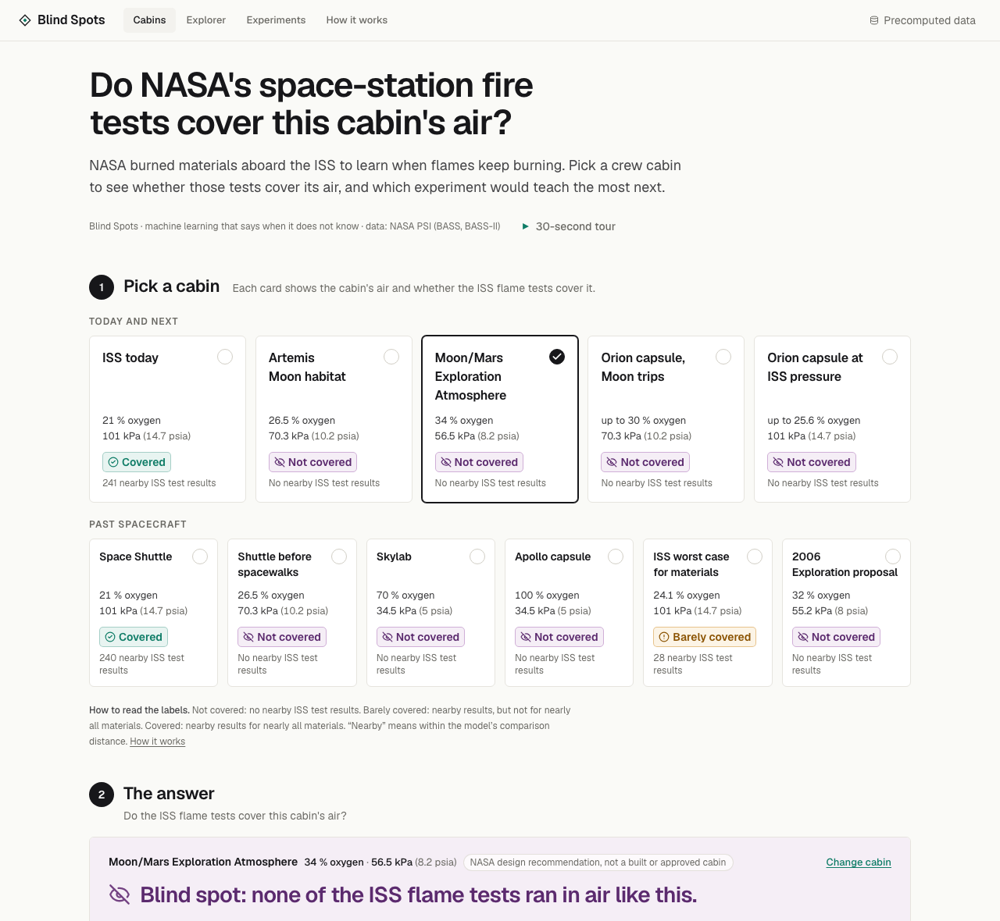
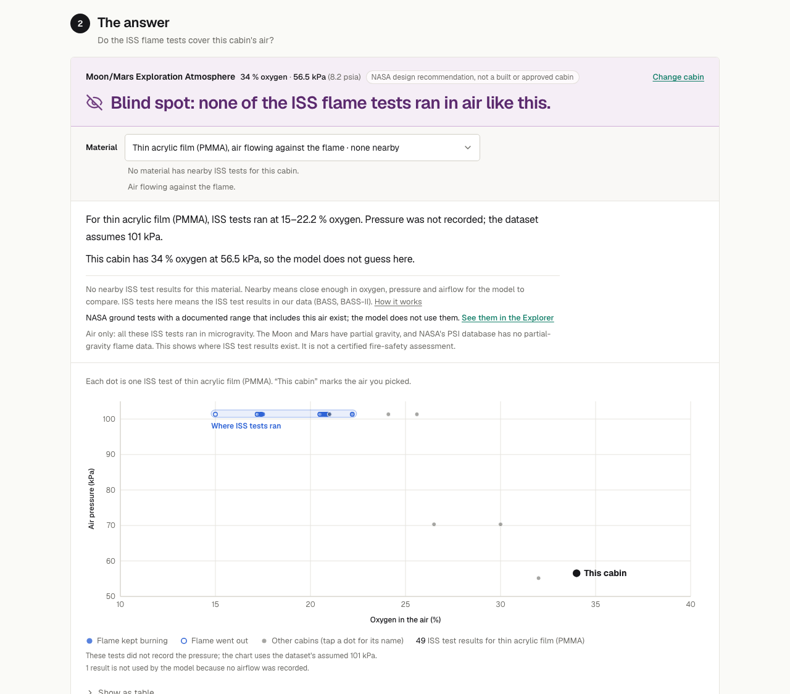

# Blind Spots

**Do NASA's space-station fire tests cover the air in a Moon or Mars cabin?**

Blind Spots shows, for any crew cabin, whether NASA's ISS flame tests ran in air like it, and which next experiment
would teach the most. Built for NASA Space Apps Challenge 2026, "Flame in Freefall". Not endorsed by NASA.

**[Live app](https://blind-spots-kappa.vercel.app)** · **[30-second video](https://blind-spots-kappa.vercel.app/video/blind-spots-demo-30s.webm)** · [Source code](https://github.com/Atharv-Sharma06/blind-spots)

> SI-assisted project: built with Claude (Anthropic). See [Use of SI](#use-of-si-super-intelligence).



## How to use it

1. **Pick a cabin.** Each card shows the cabin's air and one label: Covered, Barely covered or Not covered.
2. **Read the answer.** One line says whether ISS tests cover that air. A chart shows where the tests ran and where the cabin sits.
3. **See what to test next.** The three most useful computational research candidates, and what each could teach us.

New here? Press **30-second tour** on the live site.



More pages: **Explorer** (`/explore`, for experts), **Experiments** (`/experiments`, every test with its NASA source cell),
**How it works** (`/methodology`) and **Research brief** (`/brief`, printable).

## What we found

- All 250 ISS tests in our data ran in ISS-like air, about 1 atm. The Moon and Mars plans use thinner air with more oxygen.
- The ISS cabin has 241 nearby ISS test results. NASA's Exploration Atmosphere (8.2 psia, 34 % oxygen) has 0.
- 8 of 11 cabin atmospheres have no nearby ISS test results, including all 7 below 1 atm (Shuttle pre-EVA, Exploration Atmosphere, Artemis Surface Habitat, EAWG 2006, Orion lunar, Skylab, Apollo).
- Where there is no evidence, the app says "Insufficient experimental evidence for a reliable estimate." and shows no probability.
- Default view (NASA Exploration Atmosphere, Thin PMMA films · opposed flow): 0 of 9 sampled conditions have a nearby test result. The top research candidate is 34.0 % O2, 56.5 kPa, 1.71 cm/s, with an expected uncertainty reduction of 19.3%.
- BASS measured pressure; BASS-II did not, so the data assume the ISS cabin's 101.353 kPa for those tests.

<details>
<summary>Table: every NASA cabin atmosphere we checked</summary>

Computed by `docs/_gen/build.py` from `POST /api/target/assess` for every material setup (the same responses the static
snapshot serves). Dataset `4fe55f76142a`, model `gp-laplace-v1+4fe55f76.adfbbd`.

| documented atmosphere | O2 % | pressure kPa | comparable observations (sum over groups) | groups with any | nearest (reference distances) |
|---|---|---|---|---|---|
| ISS cabin (nominal operating range) | 21 | 101.4 | 241 | 19 | 0.1 to 2.0 |
| ISS cabin materials-testing worst case (24.1 % O2 at 14.7 psia) | 24.1 | 101.4 | 28 | 12 | 0.7 to 3.5 |
| Space Shuttle cabin (nominal) | 21 | 101.4 | 240 | 19 | 0.0 to 2.0 |
| Space Shuttle staged pre-EVA cabin (10.2 psia / 26.5 % O2) | 26.5 | 70.3 | 0 | 0 | 4.0 to 6.0 |
| NASA Exploration Atmosphere (8.2 psia / 34 % O2) | 34 | 56.5 | 0 | 0 | 8.1 to 10.3 |
| Artemis lunar Surface Habitat, nominal (10.2 psia / 26.5 % O2) | 26.5 | 70.3 | 0 | 0 | 4.0 to 6.0 |
| EAWG 2006 recommendation (8.0 psia / 32 % O2), superseded | 32 | 55.2 | 0 | 0 | 7.6 to 9.6 |
| Orion crew module design basis, lunar missions (up to 30 % O2 at 10.2 psia) | 30 | 70.3 | 0 | 0 | 5.1 to 7.4 |
| Orion crew module at 14.7 psia (analysed max O2 25.6 %) | 25.6 | 101.4 | 0 | 0 | 1.5 to 4.3 |
| Skylab cabin (5 psia / ~70 % O2) | 70 | 34.5 | 0 | 0 | 26.0 to 28.6 |
| Apollo command module cabin (5 psia / ~100 % O2) | 100 | 34.5 | 0 | 0 | 40.1 to 42.8 |

</details>

## What it does not claim

- It is a research-planning tool, not a certified fire-safety assessment, and it has no test or apparatus procedures.
  Candidates are "computational research candidates requiring qualified scientific review, established safety
  procedures and formal feasibility assessment".
- **Air, not gravity.** All ISS tests ran in free fall. NASA's PSI holds no partial-gravity combustion data, so "covered" is about the air only.
- A gap means "not represented in the integrated records", never "NASA has not studied this".
- The model beats a majority-class guess in 6 of 9 material setups. Away from 1 atm its predictions rest on an assumption, so the app shows no probability there.
- No NASA approval or endorsement is claimed.

## Use of SI (super intelligence)

- **Inside the app: machine learning, no language model.** A Gaussian-process model gives the probability that a flame keeps
  burning only where nearby ISS test results support it, and says "Insufficient experimental evidence for a reliable
  estimate." otherwise. Active learning ranks the next experiment by how much it would cut the model's uncertainty about the
  chosen cabin. Every sentence the app shows is a deterministic template filled with computed numbers.
- **To build it: Claude (Anthropic)** wrote and reviewed code, double-transcribed and checked the curation tables, extracted
  the NASA quotes and drafted the documentation. SI output was checked by code, tests and provenance checks
  rather than trusted.
- **No SI-generated images, video or audio.** The demo video and screenshots are headless recordings of the real app.

What Claude (Anthropic) was used for:

- code (Python analysis service, FastAPI API, Next.js app, tests);
- the curation tables that turn free-text BASS/BASS-II matrix cells into values: two independent SI transcriptions per
  chunk, adjudicated, with every quoted token machine-checked as an exact substring of the cited NASA cell
  (0 provenance failures in this build); see [data/curation/README.md](data/curation/README.md);
- transcription of tables from NASA reports (BASS-II Summary Report Appendix A, DARTFire, the Glenn drop-tower limits,
  Saffire-IV/V/VI, ground flammability thresholds), each row carrying its page and table reference;
- extraction of the verbatim NASA quotes behind the 12 atmosphere profiles, machine-checked against the
  downloaded documents;
- research summaries, code and science reviews, this documentation, and the scripted headless capture of the demo video
  and screenshots.

**What the people did:** the project owner directed the work, made the design and scientific decisions (logged with
their rationale in [docs/decisions.md](docs/decisions.md) and `docs/decisions.d/`), reviewed the outputs and decided what
went into the final project. Claude (Anthropic) wrote and transcribed under that direction; its output was checked by
code (`scripts/check_curation_provenance.py`, the pytest and Playwright test suites) and not trusted on its own.

**No NASA branding:** no NASA logos, flags, insignia or mission patches are used in the app, the demo video or the
screenshots. NASA datasets and experiments are named only as citations of where the data comes from. No NASA approval or
endorsement is claimed.

## Data

All model data come from public NASA records; nothing is synthetic outside unit tests.

- **BASS (PSI-26) and BASS-II (PSI-25):** ISS Microgravity Science Glovebox flammability tests (CC0-1.0, NASA PSI). Free-text
  results are interpreted in curation tables with cell-level provenance.
- **Counts:** the dataset lists 276 experiments; 250 are ISS glovebox tests. Each airflow step of a test is one
  "test result" (749 in all). The model learns from 565 test results from 210 experiments;
  184 are left out (most often because the curated reading had low confidence: 165).
- **Context only, never modelled:** Saffire, DARTFire, drop-tower and ground tests, and 16 further documented
  investigations that are not integrated.
- **Cabin atmospheres:** 12 profiles with verbatim NASA quotes in `data/manifests/atmosphere_profiles.json`.

Full list, licences and caveats: [docs/data-sources.md](docs/data-sources.md). Method and validation:
[docs/scientific-methodology.md](docs/scientific-methodology.md), [docs/validation.md](docs/validation.md).

## Run it yourself

Requirements: Python 3.12 with [uv](https://docs.astral.sh/uv/), Node.js with npm.

```bash
cd services/analysis && uv sync          # backend
cd ../../apps/web && npm ci              # web

# live mode: API, then web
cd ../../services/analysis && uv run blindspots serve    # http://127.0.0.1:8000
cd ../../apps/web && npm run dev                         # http://localhost:3000

# static-snapshot mode (what the public site serves)
cd ../../services/analysis && uv run blindspots export-artifacts --snapshot ../../apps/web/public/snapshot
cd ../../apps/web && NEXT_PUBLIC_DATA_MODE=snapshot npm run build && npm run start
```

`NEXT_PUBLIC_DATA_MODE` is `live`, `snapshot` or `auto` (default: live first, snapshot if the API is down). The repository
contains the generated dataset and model (`data/normalized`, `models/gp-laplace-v1+4fe55f76.adfbbd`, `models/retrospective`). Rebuild with
`uv run blindspots build-dataset`, `train` and `retrospective`. To regenerate every number in this README, `docs/*.md` and
`submission/*.md`:

```bash
cd services/analysis && PYTHONPATH=src uv run python ../../docs/_gen/build.py --install
```

Tests:

```bash
cd services/analysis && uv run pytest -q && uv run ruff check . && uv run mypy src
cd ../../apps/web && npm run lint && npm run typecheck && node --test tests/unit/ && npm run test:e2e
```

Public site: Vercel, static snapshot (`apps/web/vercel.json`; deploy from `apps/web` with
`npx vercel deploy --prod --archive=tgz` after exporting the snapshot). Custom targets and arbitrary candidates need the
live API and say so in the interface. macOS iCloud Desktop only: if `import blindspots` fails after `uv sync`, run
`export PYTHONPATH=src`.

## Known limits

- Few experiments per material setup (12 to 25) and most rows are "flame kept burning" (78%).
- All ISS data are at about 1 atm (98.3 to 102.2 kPa), so predictions at other pressures rest on an assumption.
- Many "sustained" labels are implied by list order in the source matrices. Airflow provenance: 332 of 565 training steps use a recorded airflow (duct reading or a value stated in the source); 233 are converted from fan or pot settings with the BASS-II calibration; none use a borrowed calibration.

More: [docs/limitations.md](docs/limitations.md). Future work (not implemented): [docs/future-work.md](docs/future-work.md).

## Documentation

[architecture](docs/architecture.md) | [data sources](docs/data-sources.md) | [scientific methodology](docs/scientific-methodology.md) | [validation](docs/validation.md) |
[evidence report](docs/evidence-report.md) | [limitations](docs/limitations.md) | [demo script](docs/demo-script.md) | [future work](docs/future-work.md) |
[decisions](docs/decisions.md) | [API](docs/API.md) | [contracts](docs/CONTRACTS.md)

## Licence and attribution

NASA PSI data (BASS, BASS-II, Saffire) are released by NASA under CC0-1.0; NTRS documents are cited with their NTRS
identifiers. Source files are never modified; derived tables are labelled as interpretations. Blind Spots is an
independent project and is **not endorsed by NASA**; it uses no NASA logos or branding. The project's own code is licensed as stated in [LICENSE](LICENSE).
